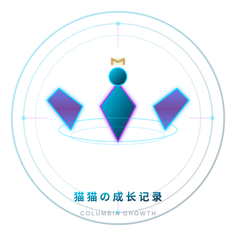

# 🌟 猫猫の成长记录

> 📍 上级目录：[Cat Projects 合集](../README.md)

<div align="center">



**时光不语，成长有迹**

纯 HTML + CSS + JavaScript 打造的成长记录网站

[](https://opensource.org/licenses/MIT)

</div>

---

## 📖 项目介绍

**猫猫の成长记录** 是一个简洁美观的成长记录网站，采用纯 HTML/CSS/JavaScript 开发，无需任何构建工具，直接在浏览器中打开即可使用。

### ✨ 特性亮点

- 🎨 **武陵城风格设计** - 新中式科幻美学，文化底蕴与科技感并存
- 🌈 **四种主题切换** - 温馨治愈 / 简约高级 / 活泼青春 / 科技未来
- 📱 **完全响应式** - 完美适配 PC、平板、手机
- 🎬 **丝滑动画** - PPT 式转场效果，流畅交互体验
- 🚀 **零配置** - 无需安装依赖，双击 HTML 文件即可运行
- 🌐 **GitHub Pages 部署** - 简单快速，免费托管

---

## 🎯 设计理念

### 核心元素
- 🦅 **哥伦比娅神鹰** - Logo 融入安第斯神鹰元素，象征成长与自由
- 🌊 **水主题** - 流动感设计，呼应武陵城水利科技
- ⚙️ **工业美学** - 混凝土质感 + 金属光泽 + 电路纹理
- 🏛️ **传统建筑** - 斗拱飞檐现代化演绎
- 🌸 **自然融合** - 梨花树、竹林、流水等自然元素

---

## 🚀 快速开始

```bash
# 方法一：双击 index.html 直接打开
# 方法二：本地服务器
cd chengzhang-growth
python3 -m http.server 8000
# 访问 http://localhost:8000
```

---

## 🎨 主题切换

点击右上角彩色圆圈按钮，可切换四种主题：

| 主题 | 风格 | 主色调 |
|------|------|--------|
| 🌸 温馨治愈风 | 温暖亲切 | 粉色 → 橙色渐变 |
| ⚪ 简约高级风 | 极简主义 | 黑白灰 + 金色 |
| 🌈 活泼青春风 | 活力四射 | 多彩渐变 |
| 🚀 科技未来风 | 赛博朋克 | 蓝紫霓虹 |

主题会自动保存在浏览器本地存储中。

---

## 📁 项目结构

```text
chengzhang-growth/
├── index.html          # 主页面
├── favicon.svg         # 浏览器图标
├── logo.svg            # Logo
├── README.md           # 项目说明（本文件）
├── 说明.txt            # 需求原始描述
├── 项目总览.md         # 总体规划文档
├── 品牌规范.md         # VI 设计规范
├── Slogan 方案.md      # 文案集合
└── 背景音乐建议.md     # 音乐方案
```

---

## 📄 相关文档

- [项目总览.md](项目总览.md) —— 总体规划（架构 / 色彩 / 交互 / 时间估算）
- [品牌规范.md](品牌规范.md) —— VI 设计规范
- [Slogan 方案.md](Slogan 方案.md) —— 文案与 Slogan 集合
- [背景音乐建议.md](背景音乐建议.md) —— 背景音乐方案
- [说明.txt](说明.txt) —— 需求原始描述

---

## 📞 联系方式

- **作者**: 猫猫
- **QQ**: 2973464622
- **邮箱**: 2973464622@qq.com

---

<div align="center">

**Made with ❤️ by 猫猫**

🌊 时光不语，成长有迹 🌊

[⬆ 回到 Cat Projects 合集](../README.md)

</div>